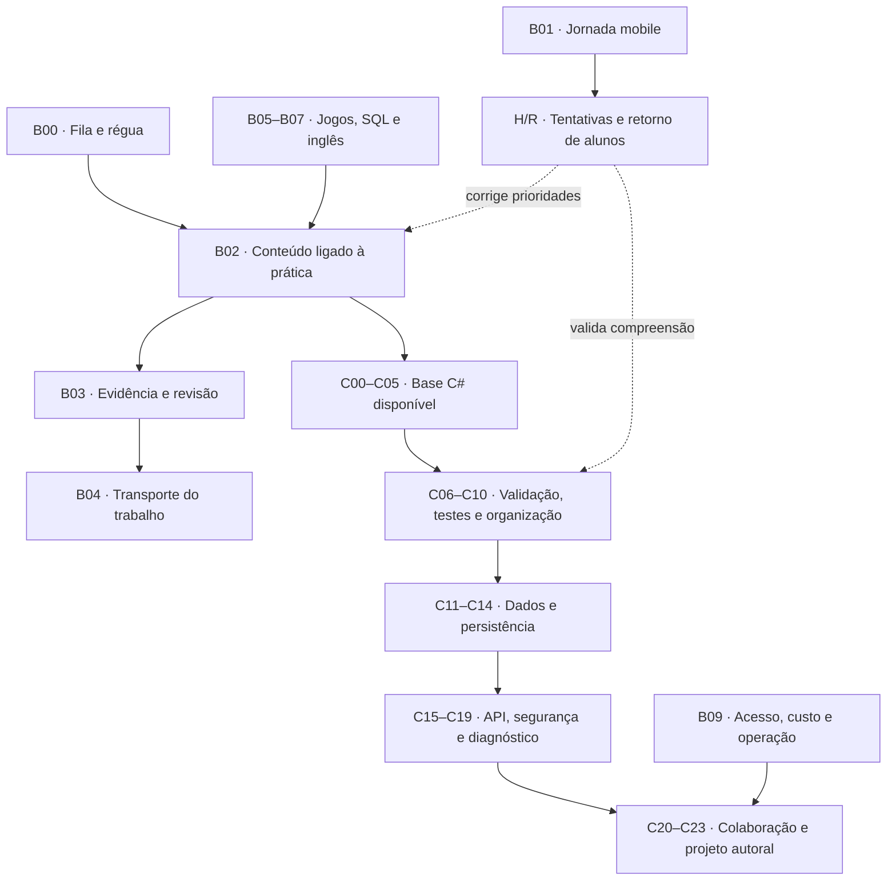

# Mapa de execução da formação Orbitamos

Versão 1 — **16/11/2026**, base publicada `a216357`.
Este arquivo é a fila de trabalho. O [controle da formação](CONTROLE_FORMACAO_ORBITAMOS.md)
define a qualidade; o [plano integral](PLANO_FORMACAO_ORBITAMOS.md) explica o diagnóstico;
o [registro de execução](EVOLUCAO_FORMACAO_ACADEMY.md) guarda as entregas.

## Ponto de retomada

- **Fechamento atual:** publicar e confirmar B00.02/B00.03/B02.02; implementação e QA concluídos.
- **Próxima após o fechamento:** B02.01 → B02.03; depois B03.01 e B04.01.
- **Aguardando participação, sem parar a fila:** H01–H03, sessão do Aluno 0.
- **Publicação-base confirmada:** `a216357`, CI `43959062550` e Vercel aprovados.
- **Cobertura estimada:** cerca de 30% do alvo, conforme a régua. Quantidade de
  tarefas concluídas não será convertida em percentual de aprendizagem.

O estado remoto desta rodada é conferido pelo commit que contém este arquivo,
CI e Vercel. A confirmação fica em `docs/local/academy-task-map-20261116/continuity.json`
no PC de autoria. Conferir esse fechamento antes de repetir uma publicação.

## Alvo e limites

Entregar uma primeira formação C# do zero a uma aplicação profissional explicável,
integrada a uma Academy visual e utilizável pelo celular. Jogos, SQL e inglês são
ferramentas do percurso. Preservar exploração livre, demais conteúdos, contas,
IDs, saves e conquistas. A home comercial fica fora desta fila.

Não inclui concluir todas as carreiras possíveis, criar um compilador .NET no
backend da Vercel, contratar serviços pagos, prometer emprego ou declarar eficácia
pedagógica sem alunos. Expansões ficam no final, sem competir com este alvo.

## Como executar a fila

1. Ler este cursor, a régua e as orientações dos arquivos afetados.
2. Selecionar a primeira tarefa **pronta** cujas dependências estão atendidas.
   Erro de dados/ensino, perda de trabalho e bloqueio de uso têm prioridade.
3. Transformar a tarefa num incremento utilizável: implementar, testar erro e
   recuperação, conferir telas quando houver UI, documentar e publicar na `main`
   já autorizada. Confirmar SHA remoto, CI e Vercel separadamente.
4. Atualizar a linha da tarefa, evidência, cursor e próximo passo. Não refazer uma
   entrega publicada apenas porque sua confirmação estava num registro local.
5. Quando faltar participação humana ou acesso real, registrar exatamente o que
   falta e seguir outra tarefa técnica independente. Nunca preencher a lacuna
   com cliques de robô, relato inventado ou resultado de referência.
6. Dividir qualquer tarefa grande antes de começar. Criar IDs filhos sem renumerar
   os anteriores. Não ampliar silenciosamente o alvo para manter a fila crescendo.
7. Manter até **uma tarefa de implementação ativa**; análises independentes podem
   ser paralelas. No PC de 6 GB, testes/build/browser/.NET pesados são seriais.

O mapa persiste no repositório. Se a sessão terminar, a próxima execução retoma
este cursor; não depende de reconstruir o plano a partir de mensagens “continue”.

### Estados e evidências

- **Feita:** o aceite técnico delimitado foi atendido; citar a evidência.
- **Pronta:** pode começar agora, sem decisão ou dependência pendente.
- **Execução:** incremento atual; ainda não é entrega pronta.
- **Planejada:** depende de outra entrega ou precisa ser dividida.
- **Participação:** requer tentativa real do aluno.
- **Acesso:** requer conta, fonte remota ou informação indisponível.

Cada fechamento distingue **I** implementação, **Q** QA técnico, **P** publicação,
**H** observação humana e **R** retorno posterior. Uma linha técnica feita não
preenche H/R. Um protocolo escrito não é uma sessão realizada. Teste do verificador
de autoria não é uma aula que ensina o aluno a escrever testes.

### Visão das dependências

O diagrama resume frentes; os aceites e estados das tabelas prevalecem.

## B00 — Execução e memória do produto

| ID | Tarefa e aceite | Estado / dependência |
| --- | --- | --- |
| B00.01 | Fixar alvo, limites e régua; distinguir cobertura, técnica e aprendizagem | Feita — controle da formação, `a216357` |
| B00.02 | Criar esta fila com IDs, dependências, aceites e cursor | Feita I/Q — 88 linhas principais, IDs únicos e links conferidos; P no fechamento atual |
| B00.03 | Ligar AGENTS, índice e régua ao mapa; impedir três listas concorrentes de “próximo passo” | Feita I/Q — dois AGENTS, índice e controle apontam à fila; P no fechamento atual |
| B00.04 | Fechar o registro rastreado da publicação `a216357`, já confirmada remotamente | Feita — controle e evolução atualizados; I/Q/P confirmados |
| B00.05 | Em cada rodada: atualizar cursor, evidência, publicação e maior risco restante | Recorrente — obrigatório em todo fechamento |

## B01 — Jornada e uso mobile

| ID | Tarefa e aceite | Estado / dependência |
| --- | --- | --- |
| B01.01 | Home → primeira missão → erro → recuperação → reload preserva o código | Feita em QA isolado — `9e060cf`; H01/R01 pendentes |
| B01.02 | Trilha C# escolhida → .NET → inglês → Home retoma a unidade correta; trocar SQL/limpar escolha respeita intenção | Feita I/Q/P — `a216357`; três perfis, sem conclusão/XP inventados |
| B01.03 | Observar teclado iPhone/Safari: símbolos, foco, edição, mudança rápida de tarefa, interrupção e retorno | Participação — H01; hipótese de foco no ensaio sintético não comprovada |
| B01.04 | Corrigir bloqueios observados, um por vez; repetir a mesma tarefa e uma variante | Planejada — B01.03/H01 |
| B01.05 | Auditar missão vazia, ajuda, Progresso e retorno pelo menu/Voltar em 320/390/desktop | Pronta — ampliar cenários existentes sem redesenhar todo o portal |
| B01.06 | Garantir rótulos e uma ação principal; tratar instruções “abaixo/ao lado” conforme layout | Pronta — inventariar ocorrências e conferir telas afetadas |

## B02 — Curadoria: conteúdo certo leva à prática certa

| ID | Tarefa e aceite | Estado / dependência |
| --- | --- | --- |
| B02.01 | Manifesto do percurso-alvo: ID, fonte, tema, pré-requisito, dispositivo, prática, revisão e lacuna de cada unidade usada | Pronta — inventário local; remoto marcado como não conferido |
| B02.02 | Remover quiz/prática por rotação do índice. Reordenar CSS Grid não pode enviá-lo a funções JS; ausência de vínculo autorado deve ser explícita | Feita I/Q — fonte, página, componentes compartilhados e regressões; P no fechamento atual |
| B02.03 | Criar vínculos por ID/slug estável, começando pelos fundamentos C#; objetivo, exemplo, prática e verificação correspondem | Pronta após B02.02 — conferir unidades uma a uma; não certificar vídeo não assistido |
| B02.04 | Conferir fontes remotas e substituir escolha por contagem em `courseSourceModules` por origem/publicação explícitas | Acesso — precisa comparar Supabase real; não remover compatibilidade às cegas |
| B02.05 | Rever materiais do percurso em celular: fonte, objetivo, integridade, alternativa legível e links | Planejada — B02.01; um material por tarefa filha |
| B02.06 | Conferir integralmente vídeos utilizados; registrar trecho/tema/data e lacunas, sem tratar metadados como revisão do vídeo | Planejada — B02.01; indisponíveis viram lacuna explícita |
| B02.07 | Revisão editorial final do percurso: sem promessa falsa, destino provisório ou assunto deslocado | Planejada — B02.03–06 |

### Subtarefas do incremento ativo B02.02

- B02.02.1: retirar seleção por índice de quiz, exercício e duração genérica;
  preservar o vínculo autorado por identidade estável. **Feita I/Q.**
- B02.02.2: preservar questões fornecidas pelo catálogo e saves antigos; zero
  questões não pode mostrar revisão completa. **Feita I/Q.**
- B02.02.3: aula sem prática específica oferece exploração livre identificada;
  navegação não aponta para uma revisão ausente. **Feita I/Q.**
- B02.02.4: conferir ordem alterada, quiz anterior, erro/acerto, reload e destino
  correto em desktop e WebKit estreito. **Feita I/Q**, incluindo contraste do quiz.
- B02.02.5: fechar tipos, lint, testes/build, publicar e registrar SHA/CI/Vercel.
  **Checks locais feitos; confirmar P após push.** Nenhuma observação humana presumida.

## B03 — Evidência e revisão que ajudam a aprender

| ID | Tarefa e aceite | Estado / dependência |
| --- | --- | --- |
| B03.01 | Mapear evidências atuais por competência: participação, guia, consulta, tentativa, verificação e artefato | Pronta — leitura dos modelos; não inferir datas/domínio retroativos |
| B03.02 | Definir contrato mínimo versionado e adaptadores para uma unidade piloto, com limite de payload e proprietário | Planejada — B03.01; sem migration obrigatória na primeira etapa |
| B03.03 | Progresso distingue ajuda, tarefa verificada e execução declarada; preserva histórico/XP | Planejada — B03.02; variantes sem ajuda não apagam consultas antigas |
| B03.04 | Dúvida contextual copiável: tarefa, intenção, código mínimo, erro, tentativa; sem enviar dados automaticamente | Pronta — modelo local e consentimento explícito para qualquer envio |
| B03.05 | Revisão por erro/habilidade com outro contexto, não repetição da mesma resposta; estado de ajuda claro | Planejada — B03.02; H/R continuam separados |
| B03.06 | “Explique ao Orbi”: aluno prevê/explica uma linha e confronta um critério; sem falsa correção por IA | Planejada — B03.02; começar por uma unidade |

## B04 — Não perder o trabalho entre sessões/aparelhos

| ID | Tarefa e aceite | Estado / dependência |
| --- | --- | --- |
| B04.01 | Inventariar saves do percurso, limites, proprietário, reset e recuperação; matriz do que já transporta e do que não transporta | Pronta — sem alterar chaves existentes |
| B04.02 | Reutilizar transporte seguro em uma prática do navegador: exportar, importar, prévia de conflito e desfazer | Planejada — B04.01; arquivo inválido/conta diferente não apagam trabalho |
| B04.03 | Estender aos formatos selecionados do percurso; erros de storage/download legíveis no celular | Planejada — B04.02; tarefas filhas por formato |
| B04.04 | Ensaiar telefone → arquivo → PC → mesma atividade com aluno, preservando código e ajuda | Participação — B04.02/H02 |
| B04.05 | Desenhar sincronização opcional: marcos, fila offline, RLS, conflitos, idempotência e consumo | Planejada — B04.01; desenho não é sincronização implementada |
| B04.06 | Implementar sincronização apenas após necessidade e orçamento medidos | Acesso/decisão — B04.05/B09.03; backup continua disponível |

## B05 — Jogos com consequência de programação

| ID | Tarefa e aceite | Estado / dependência |
| --- | --- | --- |
| B05.01 | Mapear o conceito e a ponte para código de cada jogo utilizado na formação | Pronta — Entrega é referência visual; não exigir plataforma em todo formato |
| B05.02 | Entrega: medir travadas/frame time, carga, toque simultâneo, pausa e retomada em uma rota de referência | Pronta — medir antes de otimizar; dispositivo modesto físico depende H |
| B05.03 | Corrigir a maior causa medida de travada; comparar mesmo cenário antes/depois | Planejada — B05.02; não trocar física por suposição |
| B05.04 | Uma nova situação jogável: história curta, efeito do código, erro recuperável, ajuda motora e saída para editor | Planejada — B05.01/B03.02; mecânica e linguagem explicitadas |
| B05.05 | Monte/Vila: transferência para escrita e leitura de erro, com alternativa ao arrasto | Planejada — B05.01; subtarefa por jogo, preservando conquistas |
| B05.06 | Testar se o aluno explica o conceito e o aplica fora do jogo | Participação — H04; vencer gameplay não vira domínio curricular |

## B06 — SQL dentro do mesmo projeto

| ID | Tarefa e aceite | Estado / dependência |
| --- | --- | --- |
| B06.01 | Ligar oficina/aventura às tabelas e pedidos do OrbiServiços, sem anunciar SQLite como PostgreSQL | Pronta — inventário/roteiro primeiro |
| B06.02 | Criar modelo visual de clientes/serviços e prever resultado antes de SQL; escrita com ajuda que diminui | Planejada — B06.01/C11 |
| B06.03 | Consultas relacionais: JOIN, nulos, agregação, parâmetros e casos sem resultado | Planejada — C12; verificar resultado real, não só palavras-chave |
| B06.04 | Levar consulta à aplicação, conferir persistência após reiniciar e diagnosticar erro | Planejada — C13–14 |
| B06.05 | Variante nova sem modelo e retorno posterior | Participação — H04; registrar linguagem/ambiente e ajuda |

## B07 — Inglês que serve ao trabalho

| ID | Tarefa e aceite | Estado / dependência |
| --- | --- | --- |
| B07.01 | Selecionar palavras/frases dos arquivos, erros e pedidos do projeto; vincular ao momento em que aparecem | Pronta — não criar lista infinita sem contexto |
| B07.02 | Para cada alvo: inglês correto + significado + aproximação PT-BR revisada + áudio inglês + uso no código | Planejada — B07.01; catálogo e componente compartilhados obrigatórios |
| B07.03 | Percurso ouvir → repetir → escolher uso → escrever → revisar sem revelar a resposta | Parcial — formatos publicados; seleção integrada depende B07.01–02 |
| B07.04 | Testar voz disponível/indisponível, parar/sair, movimento reduzido e retorno de sessão | Pronta — aparelhos reais em H04; não afirmar avaliação de pronúncia |
| B07.05 | Medir compreensão do inglês num erro/ticket novo do projeto | Participação — H04; falar por autodeclaração não é pronúncia verificada |

## B08 — Colaboração e ajuda sem confundir os fluxos

| ID | Tarefa e aceite | Estado / dependência |
| --- | --- | --- |
| B08.01 | Revisar transição estudante ↔ colaborador, destino do menu e retorno à prática | Pronta — usar contas sintéticas; preservar auth e permissões |
| B08.02 | Preparar ticket pequeno com contexto, aceite, diff e teste; aluno abre branch no seu projeto de estudo | Planejada — C08/C10; não editar `main` da Orbitamos como exercício |
| B08.03 | Leitura de revisão: comparar mudanças e escolher regressão que revela o defeito | Planejada — B08.02; justificar sem solução automática |
| B08.04 | Orientação de comunidade/mentoria declara disponibilidade real e contexto copiável; nenhum convite placeholder | Pronta — não prometer acompanhamento que não foi disponibilizado |

## B09 — Gratuidade, acessibilidade e operação

| ID | Tarefa e aceite | Estado / dependência |
| --- | --- | --- |
| B09.01 | Baseline de transferência de mídia, JS, duração de sessão e chamadas remotas do percurso | Pronta — separar métricas locais de quota real da conta |
| B09.02 | Auditoria teclado/toque/zoom/movimento reduzido e Axe nas telas do percurso; registrar limites | Pronta — por tela, sem declarar WCAG integral por check automático |
| B09.03 | Projetar coortes 50/100/300 por ações e dados medidos; comparar limites atuais oficiais e consumo da conta | Acesso parcial — leitura pública pode avançar; uso real da conta não inventado |
| B09.04 | Corrigir rastreamento dinâmico de arquivos na rota de materiais com allowlist/escopo estreito e testes de travessia | Pronta — erro conhecido do build; preservar materiais e auth |
| B09.05 | Orçamento de mídia por rota; lazy load e execução cliente, sem banco por tecla/quadro | Planejada — B09.01; otimizar o que foi medido |
| B09.06 | Gate de release: sem segredos, saves preservados, QA, build, SHA/CI/deploy e smoke público | Recorrente — obrigatório em cada publicação; não substitui H/R |

## C00–C23 — Formação C# profissional

Cada unidade planejada abaixo será dividida em três subtarefas estáveis:

- **`.1 — Ensinar`:** briefing do mesmo negócio, pré-requisitos, explicação visual,
  previsão e exemplo correto; indicar celular/PC e o arquivo a editar.
- **`.2 — Praticar`:** escrever/alterar/depurar, ajuda progressivamente menor,
  entradas normais e de fronteira, verificação real adequada ao ambiente.
- **`.3 — Transferir`:** pedido novo sem programa completo, artefato no mesmo projeto,
  instruções de execução, diff e critério de revisão; publicar após QA. H/R separados.

Os IDs filhos existem como parte deste mapa; antes da execução, escrever o pedido,
arquivos e casos exatos da unidade. Não marcar os três como feitos só porque há
um título no mapa. Novas unidades de dados/API não substituem validar o início.

| Unidade | Conteúdo, artefato e aceite concreto | Dependência / estado |
| --- | --- | --- |
| C00 | Ambiente e Git: abrir arquivo certo, salvar/build/run, ler erro, diff/add/commit num repositório de estudo | Guia/pacotes disponíveis; tentativa do aluno pendente em H02 |
| C01 | Variáveis/tipos/atribuição: dados e saldo de um serviço; entrada nova e atribuição incompatível tratadas corretamente | I/Q/P disponíveis no subconjunto do navegador; H01/R01 pendentes |
| C02 | Condições: regra testada abaixo/no/acima do limite, operadores lógicos e explicação do ramo | C01; I/Q/P disponíveis; H/R pendentes |
| C03 | Laços: lista pequena, acumulador, limite/fim e correção de off-by-one | C02; I/Q/P disponíveis; H/R pendentes |
| C04 | Métodos reais .NET: parâmetros/retorno/reuso e correção de retorno fixo; quatro tarefas em arquivos | C00/C01–03; I/Q/P `85911d9`; H02 pendente |
| C05 | Objetos e primeira lista: instância, construtor, referência/cópia e filtro que preserva referências/ordem/duplicatas | C04; I/Q/P `6613f3f`; é primeira unidade, não toda OO/LINQ |
| C06 | Encapsulação e validação: impedir serviço inválido sem deixar objeto parcialmente alterado | C05; planejada; observar H03 antes de publicar expansão |
| C07 | Entrada real e dinheiro: `decimal`, parsing, cultura, nullable e resultado inválido explicável | C06; planejada; casos de valor vazio/limite/dado incorreto |
| C08 | Aluno escreve testes: reproduzir defeito, teste vermelho, correção mínima e regressão automatizada | C04/C06–07; planejada; testes de referência da equipe não cumprem esta unidade |
| C09 | Coleções e LINQ: lista vazia, busca, filtro, ordenação, agrupamento e efeitos de mutação | C05/C08; planejada; resultados e preservação de entrada verificados |
| C10 | Responsabilidades/interfaces: separar regra de negócio e persistência; explicar necessidade da abstração | C06/C08–09; planejada; manter caso simples sem arquitetura ornamental |
| C11 | SQL/modelagem: clientes e serviços, chaves, tipos e restrições; modelo corresponde ao negócio | C05/C08; planejada; usa apoio B06 |
| C12 | SQL relacional: JOIN, filtros parametrizados, agregação, nulos e transação | C11; planejada; conjunto de dados com contraexemplos |
| C13 | Persistência .NET: conexão/configuração, parâmetros, erro seguro e dados após reiniciar | C07/C10/C12; planejada; segredo fora do repositório |
| C14 | EF Core: entidades, relacionamentos, migrations, consultas e controle de alterações | C13; planejada; banco local de estudo reproduzível, sem tocar produção |
| C15 | HTTP/ASP.NET Core: API de serviços, rotas, JSON, códigos de status e contrato | C08/C10/C14; planejada; pedido válido/ausente/inválido testados |
| C16 | Async/cancelamento/integração: latência, falha externa, timeout e leitura de logs | C15; planejada; não bloquear por `.Result` nem repetir gravação indevidamente |
| C17 | Autenticação/autorização: usuário só acessa seu recurso; configuração e segredo seguros | C15; planejada; teste negativo de outro usuário obrigatório |
| C18 | Testes de integração/API: preparar dados isolados, chamar endpoint, conferir banco e limpar ambiente de estudo | C08/C15/C17; planejada; aluno cria pelo menos uma regressão |
| C19 | Diagnóstico: reproduzir ticket, hipótese, log, correção mínima e teste do defeito | C16/C18; planejada; explicação e evidência antes/depois |
| C20 | CI e colaboração: branch/PR, checks, revisão de diff e correção solicitada | C08/C18/B08.02; planejada; pipeline executa testes reais |
| C21 | Reprodução e entrega: configuração, container quando necessário, health check e README utilizável por outra pessoa | C14/C15/C20; planejada; requisitos gratuitos e limites explícitos |
| C22 | Manutenção: mudança de regra/dados, investigação de performance, plano de retorno e regressão | C19/C21; planejada; medir gargalo antes de otimizar |
| C23 | Projeto autoral: escolher ticket novo, implementar, testar, documentar e demonstrar defeito corrigido | C17–22; planejada; revisão do artefato + H/R, sem promessa de emprego |

## H/R — Alunos reais e critérios de saída

| ID | Tarefa e aceite | Estado / dependência |
| --- | --- | --- |
| H01 | Aluno 0 no iPhone/Safari: encontrar missão, prever, escrever, errar, corrigir e retomar | Participação — [roteiro preparado](SESSAO_ALUNO_ZERO.md), ainda não realizado |
| H02 | No PC: levar rascunho, editar arquivo certo, executar e registrar alteração no Git | Participação — C00/C04; pode ocorrer em outra sessão |
| H03 | Explicar método/instância/referência e resolver variante nova; registrar consultas e bloqueios | Participação — C04/C05; não assumir autonomia por gostar da tela |
| H04 | Ensaiar jogo/SQL/inglês → código, identificando formato, conceito e transferência | Participação — recortes B05–07 prontos para teste |
| H05 | Observar outros iniciantes, um por vez; classificar dificuldade e corrigir maior bloqueio | Planejada — começar depois de H01; voluntários não são prova estatística |
| R01 | Retorno posterior a variável/condição com outra situação antes de rever modelo | Participação — H01; data e ajuda reais, sem intervalo “ótimo” inventado |
| R02 | Retorno ao projeto: requisito novo, teste e explicação sem o programa completo | Participação — H03/C23; não preencher por autodeclaração genérica |
| H06 | Revisão final da primeira entrega frente aos sete critérios da régua, com lacunas explícitas | Planejada — percurso técnico + H/R; não equivalência medida por opinião da IA |

## Expansão posterior — não entra como entrega pronta nem infla o alvo

- Mais carreiras profissionais: backend em outras linguagens, frontend, dados e infraestrutura.
- Novos mundos/chefes/poderes de jogos vinculados a conceitos efetivamente ensinados.
- Avaliação automática de pronúncia: somente após viabilidade gratuita e limites medidos.
- Execução .NET completa em telefone: estudo separado de download/memória/Safari/segurança.
- Recomendação adaptativa e sincronização ampla: depois de evidência/consumo e conflitos resolvidos.

## Registro desta rodada

- Mapa criado a pedido do usuário para substituir decisões improvisadas a cada retomada.
- Três análises independentes confirmaram a lacuna de curadoria, os limites do C#
  atual e a necessidade de separar técnica de observação humana.
- Exemplo reproduzível por leitura do código em B02.02: aula local CSS Grid
  `html-css-js-a9`, na posição 6, recebe link de funções JS; mover sua posição
  troca também as perguntas sem mudar o conceito. Corrigir esse contrato é a
  primeira execução funcional desta fila, sem depender de acesso ao Supabase.

### Fechamento obrigatório por incremento

Registrar ID atendido, problema do aluno, arquivos/artefato, casos corretos e
negativos, QA visual quando aplicável, H/R existentes ou ausentes, SHA/CI/deploy,
maior limitação e próximo ID pronto. Atualizar este cursor e o controle, sem
reescrever o estado histórico das publicações anteriores.

### QA de B02.02

- Next typegen/TypeScript, lint dos nove arquivos de código, **966 testes em
  78 arquivos**, nove contratos de arquivos e build de produção aprovados.
- Chromium 1366×768 e WebKit 390×664/320×640: aula sem vínculo, quiz autorado,
  questões fornecidas pelo catálogo, erro/acerto, troca/reload, saves preservados
  e link para o módulo real de condições aprovados. Zero erros de página,
  overflow e violações nos seis escopos Axe conferidos; duas falhas de contraste
  anteriores foram corrigidas, junto do alvo de toque de Refazer.
- A prévia usa os mesmos painéis da página real. Não simula carregamento
  autenticado do catálogo remoto, teste físico de teclado ou aprendizagem.
- Sem alteração de migrations, fonte canônica remota, IDs de aulas ou XP.
  O aviso de rastreamento dinâmico na rota de materiais continua em B09.04.
- Evidências locais ignoradas em `docs/local/academy-task-map-20261116/`.
