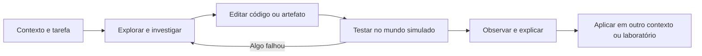

# Simulador de profissões da Orbitamos

Criado em **12/11/2026**, com pesquisa inicial, proposta e auditoria da base.
Atualização de implementação em **12/11/2026**: **protótipo implementado, com
percurso local dos dois casos conferido em três perfis de navegador**. O registro
de publicação e suas evidências remotas ficam separados do QA local, conforme
o fechamento abaixo. Não foi implementada avaliação de voz nem
ativado serviço externo para a simulação.

Este é o documento principal para retomar o projeto. Fontes e catálogo inicial:
[PESQUISA_ROTINAS_TECH.md](PESQUISA_ROTINAS_TECH.md). Projeto complementar de
voz: [INGLES_FALADO.md](INGLES_FALADO.md).

## Incremento da esteira — 13/11/2026

Depois dos dois casos de conexão, **Do teste à entrega** abre em
`/estudante/jogos/simulador#esteira`. O escritório e a equipe são os mesmos;
o computador passa a oferecer Tarefa, Arquivo, Esteira e Publicação. O objetivo
é investigar o que uma verificação verde realmente demonstra e levar a mesma
versão verificada para homologação. Nesta seção, código implementado e resultados
de verificação são registrados separadamente.

O jogador edita `smoke.config.json`, um formato educativo próprio do cenário,
com `environment: "staging"` e uma lista `checks`. Não é um arquivo de workflow
GitHub Actions. `home` representa abrir a loja; `checkout`, concluir um pedido.
O arquivo inicial contém somente `home`: esse check passa até na versão com
defeito, enquanto o pedido permanece **Não testado**. Isso não autoriza publicar.

Há dois pacotes imutáveis: `loja-014` usa `orders:3001` e falha no pedido;
`loja-015` usa `orders:3000` e o conclui. O endereço relevante permanece visível
para o aluno comparar, não apenas escolher pelo número da versão. Selecionar
um pacote não muda a instalação. A missão distingue:

1. Escrever e executar verificações de home e pedido da versão escolhida.
2. Publicar o mesmo pacote aprovado em homologação.
3. Conferir o pedido depois da publicação.
4. Enviar a evidência atual para Nina.

Home verde, publicação isolada e teste de outra seleção não concluem a tarefa.
Alterar o plano ou a versão invalida a autorização de publicar/enviar, mas não
desinstala uma versão já publicada nesta sessão. Escape/fechar/trocar de fase
cancela a ação pendente. Resultado em andamento não se transforma em conquista.

O save `orbitamos-work-delivery-v1-{tipo}-{identificação}` é independente: guarda
rascunho, seleção, tentativas e conquista histórica por conta. Não altera o save
v1 dos dois casos, o diário dos seis jogos nem XP. Resultado da esteira,
publicação ativa e conferência não voltam no reload. O Início pode retomar a
âncora exata com o título **A esteira de homologação**, fora dos contadores dos
seis jogos. A entrada exige os dois casos anteriores concluídos.

Arquivos novos: `apps/web/src/lib/workDelivery.ts`, seus testes e
`apps/web/src/components/games/WorkDelivery.tsx`/`WorkDelivery.module.css`.
A fase é carregada sob demanda. Reutiliza as artes existentes; a nova fala da
cena é opcional e preserva o comportamento dos casos anteriores. O sucesso no
escritório só aparece com verificações e conferência da publicação atuais.

Base técnica conferida em 13/11: a documentação do GitHub explica
[artefatos produzidos e compartilhados entre jobs](https://docs.github.com/en/actions/concepts/workflows-and-actions/workflow-artifacts)
e [jobs que dependem da conclusão bem-sucedida de outros](https://docs.github.com/en/actions/how-tos/write-workflows/choose-what-workflows-do/use-jobs).
A missão adapta essas relações a um modelo determinístico local, sem executar
Actions, baixar pacotes do aluno, acessar `orders` ou publicar infraestrutura real.
Uma futura prática em repositório deverá trabalhar o YAML e as ferramentas reais.

### Verificação da esteira — 13/11/2026

O roteiro `audit-work-delivery.mjs` passou em desktop, WebKit/iPhone 13 e tela
de 320 px: **19 verificações e 15 estados capturados por perfil**, com Axe dos
blocos exercitados e checagem de limites horizontais. Foram conferidos o bloqueio
por pré-requisito, verde incompleto, JSON/ambiente/chaves/checks inválidos,
recuperar/desfazer, falha da versão 014, cancelamento dos três timers por Escape,
troca de versão sem reutilizar autorização, publicação sem concluir, conferência
e envio, retomada exata, duas contas e preservação dos saves/XP anteriores.
Não houve exceções JavaScript, requisições ao endereço representado ou escrita RPC.

Na revisão visual, o retorno à primeira instalação foi explicitado no enredo.
A barra de fechar do computador passou a acompanhar a rolagem; trocar de painel
retorna às suas instruções. Um smoke adicional em WebKit/iPhone e 320 px confirmou
fechar acessível depois de rolar e painel começando no topo. Arquivo não salvo
mostra aviso dentro do editor; autorização atual também é exigida no botão de
conferir/enviar, mesmo que uma publicação anterior continue instalada.

Os **621 testes da suíte geral passaram em 65 arquivos**, incluindo modelo,
contas, persistência e navegação. Os **9 contratos estáticos** passaram; lint
terminou com **0 erros e os 29 avisos anteriores**. Build e verificação remota
ficam separados: o **build local de produção passou, incluindo TypeScript**;
a conferência de SHA, GitHub Actions e Vercel é registrada em
`production-verification.json`. Logs e registro remoto desta
rodada ficam em `docs/local/work-delivery-20261113/`; capturas e relatórios em
`apps/web/test-results/work-delivery/`, fora do Git.
A regressão desktop dos dois casos anteriores também passou, incluindo a ida
pela âncora nativa `#esteira` e a volta ao escritório anterior sem reescrever
as conquistas. O Início agora sugere a esteira depois dos dois casos de conexão.
WebKit com perfil de iPhone não substitui o aparelho físico, teclado virtual,
áudio audível nem validação pedagógica com uma pessoa iniciante.

## Protótipo implementado — 12/11/2026

O recorte implementado é o episódio **Primeiro turno**, papel **DevOps**, na
empresa fictícia **Loja do Bairro**. O escritório 2D tem Orbi, Nina, Jo e um
computador interativo. A experiência conecta relato, mapa dos serviços, log,
edição de configuração, aplicação, teste do pedido e entrega da evidência.

A cena usa DOM/CSS e um loop de movimento com `requestAnimationFrame`, sem
adicionar um novo renderer ao bundle. Posição e câmera não atualizam React
por quadro; o loop dorme sem deslocamento. Pausa, saída da aba e desmontagem
liberam controles/recursos. Sons opcionais reutilizam `ChapterAudio`, com
desbloqueio em gesto, mute e pausa. A Entrega mantém sua engine Phaser própria.

| Caso | Situação e ação |
| --- | --- |
| `checkout-staging` — O pedido que não chega | O checkout procura `orders:3001`, enquanto pedidos atende em `orders:3000`. O aluno investiga e corrige a configuração de homologação, com pistas graduais. |
| `checkout-transfer` — Uma nova porta | Uma instalação diferente atende em `orders:4100`; reaproveitar a configuração da porta 3000 não resolve o caso. A variação abre depois da primeira entrega e oferece menos ajuda. |

O artefato editável é `checkout.config.json`, limitado aos campos `environment`
e `ordersBaseUrl`. Ticket, mapa, log, diff e resultado do pedido representam os
artefatos de investigação e entrega. JSON inválido permanece editável e não
substitui a última configuração aplicada. Digitar, aplicar, verificar e concluir
são ações distintas. A entrega exige um teste aprovado do caso e da configuração
aplicada; a página inicial abrir sozinha não satisfaz essa condição. Não há shell,
requisição ao endereço escrito ou alteração em produção.

O save v1 separado por conta guarda seleção do caso, rascunhos, tentativas e
conquistas. Configuração aplicada e resultado do teste não sobrevivem ao reload:
retomar o arquivo exige aplicar e verificar novamente. Concluir o primeiro caso
grava o próximo como ponto de retomada; a conversa de revisão ainda apresenta o
ticket que acabou de ser entregue. Recuperar o arquivo inicial permite desfazer
a recuperação e não apaga conquistas.

A entrada única **Simulações de trabalho** fica dentro de Praticar/Jogos, com
destino canônico `/estudante/jogos/simulador` e prévia exclusiva de desenvolvimento
`/dev/work-simulation-preview`. A prévia iniciada pela Academy usa
`?from=academy`, a mesma conta de preview e o mesmo destino canônico de retomada.
O Início projeta a empresa e o caso do save somente quando esse destino está
selecionado no índice de retomada. A coleção permanece fora da união fechada de
seis atividades, dos seus denominadores e do XP existente. Não houve mudança na
barra lateral nem sincronização de saves entre aparelhos.

Arquivos principais desta implementação:

- `apps/web/src/components/games/WorkSimulation.tsx` e
  `WorkSimulation.module.css`: interface do turno e computador.
- `apps/web/src/components/games/work-simulation/OfficeScene.tsx` e
  `OfficeScene.module.css`: escritório, deslocamento e interações.
- `apps/web/src/lib/workSimulation.ts` e `workSimulation.test.ts`: conteúdo,
  validação, teste local, conclusão e persistência.
- `apps/web/src/lib/academyActivity.ts` e `portalNavigation.ts`: retomada e
  navegação canônica, sem novo prêmio.
- `apps/web/src/components/estudante/PracticeStation.tsx`: coleção visual.

Este recorte não implementa as seis missões do turno completo, novos papéis,
containers reais ou o projeto de inglês falado. A pesquisa e o planejamento
iniciais abaixo mantêm seu escopo e sua data; não são promessa de conteúdo já
disponível.

### Arte, origem e prompts

Assets novos gerados com **ImageGen integrado**, no modo builtin, em 12/11.
São cenário e personagens fictícios para o jogo, não retratos da equipe real.
Os originais permanecem na pasta de imagens geradas do Codex. Sharp foi usado
para recorte/exportação do atlas e compressão WebP, preservando transparência.

| Asset no aplicativo | Formato/tamanho | Origem |
| --- | --- | --- |
| `apps/web/public/images/games/work-simulation/office-v1.webp` | 1536×1024, 222454 bytes | `exec-ec457707-9937-480a-8d64-e0bff39b774a.png` |
| `apps/web/public/images/games/work-simulation/team-v1.webp` | 1024×512, 48920 bytes, alpha; Nina/Jo em duas células | `exec-2566f7e4-41aa-44fd-b62f-be8ec2ca62d1.png` |
| `apps/web/public/images/jogos/simulador-trabalho-v1.webp` | 1200×504, 92388 bytes | Captura real do escritório pelo roteiro desktop, recortada/exportada com Sharp |

O Orbi reutiliza `images/games/orbi-chapter/orbi-sheet-v1.webp`, sem substituir
o original. A capa da coleção mostra o protótipo real conferido no desktop.
Áudio usa os sons sintetizados existentes, sem arquivos ou serviço de voz novos.

<details>
<summary>Prompts finais das duas artes (geração integrada)</summary>

Escritório:

```text
Use case: stylized-concept. Asset type: production background for an original
Orbitamos 2D walkable office learning game. Create a polished, charming, richly
hand-painted game environment, wide landscape 3:2 composition. A small Brazilian
technology studio helping a neighborhood online shop: warm oak floor, rounded
teal desks, cream plaster, terracotta accents, plants, shelving, afternoon light
through a back window with leafy rooftops. Orthographic cutaway interior, gently
elevated three-quarter near-isometric view like an authored cozy life-sim game,
sophisticated material shading matching a friendly glossy teal space-robot
mascot (the mascot will be added by code; DO NOT draw it). Three useful stations
arranged in the UPPER HALF: a lead's desk at upper-left, a dual-monitor computer
workstation at upper-middle, and a customer-service desk with a monitor at
upper-right. Lower half and center must remain a broad continuous uncluttered
walkable floor with subtle floor texture, inviting enough to move a character
around; furniture does not obstruct that lower walking area. A small tasteful
orbit/planet motif on the wall, no lettering. Fine authored details, readable
silhouettes, cinematic warm/cool balance, premium indie-game art rather than
generic flat icons or pixel art. Fill the entire canvas with the room, no
floating diamond room, no border, no UI, no panels or labels, no text, no
characters, no people, no robots. Do not make a website mockup. This is the
background layer for an interactive scene, not a static screenshot of a
completed game.
```

Personagens, com transparência solicitada:

```text
Use case: stylized-concept. Asset type: two character sprites for an original
cozy Orbitamos office learning game. Create a polished character sprite atlas on
a genuinely transparent background, square canvas. Exactly TWO separate full-body
friendly adult Brazilian coworkers, equal visual scale, no overlap. LEFT HALF:
Nina, adult Black Brazilian woman, short natural curly black hair, warm expressive
face, casual navy blazer over a cream top, terracotta lanyard with plain badge,
relaxed trousers and white sneakers, holding a slim tablet. RIGHT HALF: Jo, young
adult Brazilian man, medium brown skin, dark wavy hair, teal overshirt over cream
T-shirt, charcoal trousers and casual sneakers, one relaxed hand lightly raised
to talk. Both standing on the same baseline, full bodies including feet visible,
facing slightly inward in a three-quarter view, softly rounded premium stylized
3D game character aesthetic with beautiful painted shading, expressive but not
childish, coherent with a glossy friendly teal space-robot mascot. Each person
centered in their own half with clear transparent margins; sprite-like even
lighting, gentle grounded footwear shading only, absolutely no floor, no scene,
no desk, no furniture, no typography, no labels, no borders, no watermark. Not
photoreal people, not flat icons, not pixel art. The two halves will be cropped
as separate sprites for an interactive office scene.
```

</details>

### Fechamento local — 12/11/2026

O roteiro `scripts/audit-work-simulation.mjs` completou os dois casos por ações
da interface nos perfis desktop, WebKit/iPhone 13 e celular de 320 px, em série.
Foram 15 verificações por perfil: falha inicial 502, rejeição de JSON inválido,
ambiente de produção, endereço externo e chave extra; recuperação/cancelamento/
desfazer; porta válida errada; cancelamento do teste por Escape; pausa durante
deslocamento; reload sem reaplicar; retomada pelo Início; isolamento de contas;
invalidação de evidência antiga; aplicação/teste/envio em cada caso e preservação
dos saves/XP antigos. Não houve pedido aos hosts digitados nem escrita RPC.

Capturas dos 16 estados, relatórios, exceções JavaScript, limites horizontais e
Axe dos blocos exercitados ficam em `apps/web/test-results/work-simulation/`,
ignorados pelo Git. A capa da coleção foi extraída da captura real desktop.
Foram corrigidos o alvo de interação que mantinha a cena pausada depois de
fechar uma conversa, a ordem de abertura dos diálogos e o foco do painel do
computador. O roteiro confere o controle de som; não mede qualidade audível.

A suíte geral passou **598 testes em 64 arquivos**; os contratos estáticos de
colaborador/Supabase passaram **9 testes**. O build de produção passou, incluindo
TypeScript. O lint terminou com **0 erros e 29 avisos**, em arquivos anteriores
à implementação. Logs dos comandos desta rodada ficam
em `docs/local/work-simulation-20261112/`. A verificação remota de SHA, GitHub
Actions e Vercel fica em `production-verification.json` nessa mesma pasta;
resultados locais não comprovam publicação nem uso autenticado em produção.

Restam validação com uma pessoa iniciante, iPhone/Safari físico, teclado virtual,
áudio e desempenho no aparelho. WebKit no Windows não comprova esses pontos.
As outras missões do turno, infraestrutura real e inglês falado continuam no
plano. O próximo incremento deve partir dessa observação, preservando os dois
casos entregues, a conta e suas conquistas.

## Produto e experiência pretendida

Uma pessoa entra numa empresa fictícia como profissional de tecnologia. Conhece
colegas, recebe tarefas, investiga problemas, trabalha no computador do cenário
e vê as consequências das suas decisões. Orbi acompanha o início; gradualmente,
o aluno ganha autonomia e aprende a pedir revisão e ajuda quando precisa.

A referência a Minecraft/The Sims orienta presença, exploração, personagens,
objetos interativos e consequências. A primeira entrega proposta é uma cena
2D, vista de cima ou em perspectiva isométrica, com um escritório reconhecível.
Movimento, som, conversas curtas e animações acompanham trabalho efetivo: ler
um log, alterar um arquivo, testar e verificar o resultado.

O produto cresce por **papel + contexto de empresa + episódio + competências**.
Uma profissão pode aparecer em várias empresas. Um episódio pode reunir
competências de mais de uma área. O mapa inicial é expansível; não é um
levantamento concluído de todas as profissões existentes.



## Complexidade e decisões recomendadas

Avaliação relativa de engenharia e conteúdo, não estimativa contratual de prazo.

| Escopo | Complexidade | O que concentra o trabalho |
| --- | --- | --- |
| Uma empresa, um papel DevOps, seis missões em 2D | Média-alta | Mundo, interações, estado técnico, avaliação, arte e usabilidade mobile |
| Outro contexto para o mesmo papel | Média após validar o motor | Novos problemas, regras e revisão técnica; reutilização precisa ser comprovada |
| Backend, frontend, dados, segurança e outras áreas | Alta e contínua | Pesquisa, artefatos, validadores e revisão por área, além de cenários |
| Mundo 3D aberto, construção livre e NPCs autônomos | Muito alta | Outra escala de câmera, animação, física, persistência, autoria e desempenho |
| Laboratórios com containers e infraestrutura reais | Muito alta | Isolamento, execução, recursos, credenciais, limpeza e operação |

A maior complexidade é fazer o trabalho simulado reagir de forma coerente e
ensinar algo transferível. Colocar um personagem diante de um questionário
resolve apenas uma pequena parte da proposta.

**Decisões iniciais propostas:**

- Começar por DevOps numa empresa fictícia pequena, com serviços gerenciados.
- Usar cena 2D com a identidade aprovada do Orbi e interações próprias do gênero.
- Personagens com falas e ramificações autorais; nenhuma API de LLM obrigatória.
- Avaliar artefatos, estado e verificação; permitir soluções equivalentes quando
  forem válidas no escopo do episódio.
- Carregar o episódio aberto sob demanda e manter a simulação no navegador.
- Preservar as três entregas e a Oficina do Pulso como experiências próprias.

## Piloto: primeiro turno na equipe de uma loja

Empresa fictícia de comércio local que vende pela internet. O aluno participa
da operação e entrega de software com supervisão. Essa combinação de funções é
uma escolha do cenário; a pesquisa não afirma que toda empresa contrata um
DevOps com essas responsabilidades.

Personagens propostos: Orbi como mentor, uma pessoa responsável pelo time,
uma colega de desenvolvimento e alguém do atendimento. O responsável apresenta
prioridades e limites de atuação; colegas também trazem informações e revisam
mudanças. Pedir esclarecimento pode ser uma boa decisão do jogador.

### Episódio inicial — um pedido de teste não chega ao fim

1. **Entrar na equipe.** Explorar o escritório e o computador; reconhecer
   desenvolvimento, homologação e produção num mapa simples do serviço.
2. **Entender o problema.** Durante o teste de uma nova versão em homologação,
   atendimento relata que a loja abre, mas o pedido falha. Reproduzir o sintoma
   e localizar uma evidência no log do checkout. Produção não está afetada.
3. **Preparar uma mudança.** Corrigir uma configuração no ambiente seguro,
   comparar o diff e explicar ao colega o motivo da alteração.
4. **Ler o teste que falhou.** Investigar a saída da esteira simulada e resolver
   a causa. Apagar o teste não satisfaz a missão.
5. **Publicar em homologação.** Selecionar o artefato testado, usar a configuração
   do ambiente e verificar o pedido com um teste curto de funcionamento.
6. **Entregar e aprender.** Registrar evidências no ticket de correção em
   homologação, responder à revisão e enfrentar uma variação com menos ajuda.
   Esse ticket pode ser concluído após QA. A mudança em produção permanece
   pendente de autorização e verificação no ambiente de destino.

Cada missão tem uma ação pequena, uma consequência visível e uma evidência de
entendimento. O turno pode ser interrompido e retomado em blocos curtos; duração
e quantidade de texto devem ser calibradas com iniciantes.

### Exemplo de consequência jogável

O jogador muda a porta de um serviço e aplica a configuração. O painel do
computador, o fluxo dos pedidos e a fala do atendimento refletem o novo estado.
Se a alteração estiver sintaticamente válida, mas ainda não resolver o problema,
o cenário mostra a falha restante. A missão termina depois da verificação e do
registro de evidências, não apenas ao aceitar a edição.

Nas primeiras tentativas, Orbi explica cada objeto e oferece pistas graduais.
Mais tarde, o aluno decide onde procurar e qual mudança propor. A matriz com
expansões de monitoramento, incidente, infraestrutura e plataforma está no
[dossiê de pesquisa](PESQUISA_ROTINAS_TECH.md#missoes-propostas-para-operacao-e-entrega).

### Recorte exato do primeiro protótipo

Identificação proposta: episódio `devops-loja-01`, missão `checkout-staging`.
Antes de construir o turno inteiro, entregar uma pequena missão jogável que
conecta investigação, edição e verificação:

- Um colega chama o jogador ao computador. O objetivo visível é **Fazer o
  pedido de teste funcionar em homologação**.
- O computador oferece o ticket, um mapa simples dos serviços, um log e o
  arquivo `checkout.config.json`. O serviço de pedidos do cenário atende na
  porta 3000, mas o checkout está configurado para procurar a porta 3001.
- O jogador lê as evidências e altera o arquivo. A primeira pista explica
  o significado de endereço e porta; pistas seguintes ajudam gradualmente.
- Aplicar uma edição válida muda a configuração ativa. Um teste simulado do
  fluxo de pedido produz resultado observável; a home pode continuar abrindo
  mesmo enquanto o pedido falha.
- O atendimento reage ao teste. A missão requer configuração adequada,
  pedido de teste concluído e evidência registrada no ticket do ambiente.
- Uma variação posterior muda a porta do serviço e reduz o apoio, para verificar
  que o aluno compreendeu a relação em vez de memorizar o número 3000.

Arquivo inicial proposto, sem dados reais:

```json
{
  "environment": "staging",
  "ordersBaseUrl": "http://orders:3001"
}
```

`orders` é um serviço fictício do mundo simulado. Nenhuma URL digitada deverá
virar requisição externa. Validar o JSON, as propriedades permitidas e o estado
do serviço virtual; respeitar soluções equivalentes aceitas pelo cenário, não
comparar o arquivo inteiro com uma string. Código inválido mantém a última
configuração aplicada e o rascunho editável.

Esse recorte não inclui um terminal Linux completo. A programação/configuração
entra numa ação real do episódio, e o cenário dá o contexto. No celular, tarefa
e área de trabalho devem ser fáceis de alternar, com objetivo curto sempre
reconhecível, botões rotulados, retorno e pausa.

## Pedagogia e avaliação

- Mostrar o objetivo com a cena, poucos rótulos e uma tarefa clara. Informações
  necessárias para resolver o trabalho permanecem disponíveis.
- Alternar demonstração curta, tentativa guiada, mudança de exemplo e aplicação
  independente. Repetir uma ideia em outro contexto verifica transferência.
- Incluir investigação, prevenção, documentação, colaboração e revisão. O jogo
  não deve representar o trabalho como uma sucessão permanente de emergências.
- Distinguir sintaxe aceita, alteração aplicada, resultado observado e missão
  concluída. Esses estados não significam a mesma coisa.
- Avaliar pelo estado relevante e pelos artefatos: versão correta, teste útil,
  evidência do impacto e verificação posterior. Um comando aceito não prova
  que o problema foi resolvido.
- Recuperação e feedback devem permitir corrigir o erro. Desfazer uma ação no
  cenário não apaga conquistas anteriores.
- Medir ajuda usada e uma aplicação independente pode orientar a próxima prática;
  isso não vira uma nota automática de empregabilidade.
- Oferecer diferentes representações da mesma ideia, sem classificar pessoas
  em estilos de aprendizagem fixos.

As bases educacionais estão identificadas no dossiê. Elas sustentam escolhas
de desenho instrucional; não demonstram a eficácia deste simulador ainda não
construído. A simulação deverá terminar com prática relacionada num repositório
ou laboratório real. O suporte atual a C# não é um runtime .NET completo.

## Arquitetura proposta

Criar uma experiência de simulação de trabalho separada da cena de plataforma
atual. Reaproveitar padrões de lifecycle, áudio, pausa, acessibilidade e
carregamento sob demanda, sem transformar `ChapterScene` num motor de todas
as profissões.

| Camada | Responsabilidade |
| --- | --- |
| Conteúdo | Empresa, papel, personagens, briefing, tickets, fontes e pistas |
| Estado do trabalho | Serviços, versões, ambientes, incidentes, permissões e consequências |
| Avaliação | Regras determinísticas, invariantes, artefatos e evidências de conclusão |
| Apresentação | Escritório, personagens, computador, diálogos, sons e animações |
| Persistência | Conta, conteúdo versionado, rascunhos, checkpoints e conquistas |

O conteúdo referencia ações e verificações registradas pelo motor. Arquivos de
missão não recebem JavaScript arbitrário para executar. Um episódio novo deve
ser validado como conteúdo antes de ganhar novas regras de runtime.

### Contrato futuro de episódios expansíveis

Esquema proposto para expansão, não uma API já implementada. O recorte atual
usa tipos menores em `workSimulation.ts`; não contém ainda todo este contrato:

```text
id, contentVersion, companyContextId, roleIds, responsibilityLevel
prerequisites, competencies, toolsRepresented, sourceRefs, reviewedAt
characters, brief, initialState, allowedActions, editableArtifacts
objectives, successRules, failureFeedback, hints, independentVariant
checkpointPolicy, debrief, transferActivity
```

IDs de competências, episódios e missões permanecem estáveis. Fontes e revisão
fazem parte do conteúdo. Mudanças incompatíveis exigem uma decisão explícita
sobre migração do save; não reinterpretar uma conquista antiga como conclusão
de um episódio novo.

### Base existente conferida no levantamento inicial de 12/11

- `apps/web/src/components/games/OrbiChapterCanvas.tsx` e
  `games/orbi-chapter/engine.ts`: lifecycle, carregamento Phaser, controle e pausa.
- `apps/web/src/lib/orbiChapter.ts`, `orbiPulse.ts` e
  `orbiPulsePrediction.ts`: programa, consequência e avaliação separados.
- `apps/web/src/lib/practiceStation.ts` e
  `components/estudante/PracticeStation.tsx`: catálogo e ligação com práticas.
- `apps/web/src/lib/academyActivity.ts`, `portalNavigation.ts` e
  `components/estudante/AcademyResumeTracker.tsx`: retomada por conta e URL validada.
- `apps/web/src/lib/academyCatalog.ts` e `academyStudyPath.ts`: ligação às trilhas.
- `apps/web/src/lib/browserCodeRunner.ts`, `sqlRunner.ts` e workers em
  `apps/web/public/`: referências de cancelamento e execução educativa no cliente.

No levantamento inicial, essa base oferecia partes reutilizáveis e ainda não
continha o motor proposto. O recorte implementado depois está registrado acima.
O parser do Pulso aceita duas declarações numéricas; não executa Linux, Docker
ou Kubernetes. C# também usa um subconjunto educativo, não Roslyn/.NET completo.

### Navegação e progresso

Manter Início, Trilhas, Praticar, Progresso e Comunidade. Uma entrada visual
**Simulações de trabalho** dentro de Praticar leva a papéis, contextos e episódios.
Trilhas relacionadas apontam para o mesmo conteúdo, com destino canônico único.
Publicar primeiro o que é jogável; não criar uma vitrine de dezenas de cursos
vazios antes do piloto.

Na proposta inicial, a rota candidata `/estudante/jogos/simulador` ainda não
existia. Ela exigia implementação explícita: o `[slug]` de jogos pertence ao Monte o Código.
Catálogo, resumo, revisão, retomada e preview precisam de registro próprio.
Há seis atividades numa união fechada e contadores fixos na central; revisar
esses contratos antes de inserir outra coleção.

Save separado e versionado, com rascunhos e evidências pequenas. Retomada deve
identificar empresa, episódio e tarefa. O progresso atual dos jogos é local ao
navegador/conta; continuidade entre aparelhos é trabalho adicional. A RPC de XP
de aulas não é um endpoint genérico de premiação. Definir qualquer novo prêmio
e sua validação antes de integrá-lo; não reutilizar a conclusão da Entrega.

## Execução segura e custo

No piloto, o computador do cenário representa arquivos, serviços e comandos
limitados de uma empresa fictícia. As ações mudam esse mundo no cliente.
O produto precisa explicar esse escopo. Não solicitar credenciais reais nem
encaminhar comandos do aluno ao shell da hospedagem ou à produção da Orbitamos.
Worker ajuda no controle de execução; não é isolamento suficiente para oferecer
infraestrutura arbitrária de terceiros.

Laboratórios reais com containers/cloud ficam numa fase distinta, com projeto
de isolamento, recursos, encerramento e custo. Eles não surgem automaticamente
por utilizar Vercel e Supabase.

É plausível construir o primeiro simulador sem contratar IA ou servidores novos.
Continuam existindo limites de hospedagem e transferência de mídia. Carregar só
o episódio aberto, reaproveitar assets e salvar marcos úteis; não enviar estado
de NPC, passos, comandos ou eventos por quadro ao Supabase.

**Restrição de planejamento verificada em 12/11:** a documentação do
[Vercel Hobby](https://vercel.com/docs/plans/hobby) limita o plano a uso pessoal
não comercial. Portanto, custo técnico baixo não permite prometer esse plano
como hospedagem comercial gratuita. Não foi conferido o plano da conta nesta
rodada e nenhuma contratação ou migração foi realizada. O
[Supabase também tem cotas](https://supabase.com/docs/guides/platform/billing-on-supabase);
o plano depende do uso agregado do projeto, não só deste jogo.

## Plano de execução com portas de qualidade

| Etapa | Entrega | Critério para avançar |
| --- | --- | --- |
| 0. Base de pesquisa | Este plano, catálogo inicial e dossiê de voz | Fontes e limites identificados; pesquisa não apresentada como jogo entregue |
| 1. Uma missão completa | Cena, Orbi/colega, computador, edição, consequência e retomada | Um iniciante entende o pedido, age e explica o que mudou no desktop e celular |
| 2. Primeiro turno | As seis missões, pistas, revisão e variação independente | Percurso completo com erros, recuperação e evidências; sem depender só de copiar |
| 3. Segundo contexto DevOps | Outro ambiente de empresa no mesmo motor | Reutilização comprovada e regras contextualizadas, sem duplicar toda a engine |
| 4. Backend C# | Episódio de requisito, API, dados, teste e revisão | Ações e ferramentas representadas corretamente; ponte para prática .NET real |
| 5. Novas famílias | Frontend/qualidade, dados, segurança e demais áreas por pesquisa | Cada ramo tem tarefas, fontes, revisão e aplicação independente próprias |
| 6. Evolução visual | Mais ambientes, poses, reações e eventual estudo 3D | Ganho de compreensão/jogabilidade e desempenho medido justificam a mudança |

Não há cronograma de dias fechado: o protótipo precisa revelar quanto custam
interações, autoria e desempenho no aparelho-alvo. Estimar cada etapa depois de
um episódio vertical evita transformar o tamanho do catálogo em promessa.

## Retomar depois de perder o contexto

1. Ler este documento, o dossiê de rotinas, `docs/PADRAO_VISUAL_ACADEMY.md` e o
   registro de evolução da Entrega. Conferir `git status` e instruções aplicáveis.
2. Preservar o arquivo pessoal `apps/web/CLAUDE.md` sem ler ou incluir em commits;
   material sincronizado em `sources/` continua somente leitura.
3. O recorte **`checkout-staging`** e a variação **`checkout-transfer`** têm
   implementação registrada acima. A fase **`#esteira`**, de 13/11, tem modelo,
   interface e save independentes. Retomar pelos dois fechamentos: conferir
   resultados, evidências e publicação da rodada antes de ampliar o turno.
   As demais missões e famílias do catálogo continuam como planejamento.
4. Registrar decisão, problema observado, causa, alteração, teste e pendência.
   Marcar separadamente código implementado, QA local e publicação verificada.
5. Validar com uma pessoa iniciante e em iPhone/Safari físico. Conferir toque,
   teclado, texto, retorno, pausas, consumo e tamanho dos downloads antes de
   aumentar cenários. WebKit no Windows não comprova esse aparelho.
6. Atualizar fontes quando as tarefas, ferramentas ou contexto mudarem. A data
   de revisão do texto não renova automaticamente uma pesquisa de mercado.
