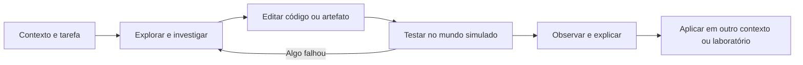

# Simulador de profissões da Orbitamos

Criado em **12/11/2026**. Estado: **projeto proposto, com pesquisa inicial e
auditoria da base atual**. Esta rodada não implementa um novo jogo, não ativa
serviços e não acrescenta avaliação de voz ao produto.

Este é o documento principal para retomar o projeto. Fontes e catálogo inicial:
[PESQUISA_ROTINAS_TECH.md](PESQUISA_ROTINAS_TECH.md). Projeto complementar de
voz: [INGLES_FALADO.md](INGLES_FALADO.md).

## Produto e experiência pretendida

Uma pessoa entra numa empresa fictícia como profissional de tecnologia. Conhece
colegas, recebe tarefas, investiga problemas, trabalha no computador do cenário
e vê as consequências das suas decisões. Orbi acompanha o início; gradualmente,
o aluno ganha autonomia e aprende a pedir revisão e ajuda quando precisa.

A referência a Minecraft/The Sims orienta presença, exploração, personagens,
objetos interativos e consequências. A primeira entrega proposta é uma cena
2D, vista de cima ou em perspectiva isométrica, com um escritório reconhecível.
Movimento, som, conversas curtas e animações acompanham trabalho efetivo: ler
um log, alterar um arquivo, testar e verificar o resultado.

O produto cresce por **papel + contexto de empresa + episódio + competências**.
Uma profissão pode aparecer em várias empresas. Um episódio pode reunir
competências de mais de uma área. O mapa inicial é expansível; não é um
levantamento concluído de todas as profissões existentes.



## Complexidade e decisões recomendadas

Avaliação relativa de engenharia e conteúdo, não estimativa contratual de prazo.

| Escopo | Complexidade | O que concentra o trabalho |
| --- | --- | --- |
| Uma empresa, um papel DevOps, seis missões em 2D | Média-alta | Mundo, interações, estado técnico, avaliação, arte e usabilidade mobile |
| Outro contexto para o mesmo papel | Média após validar o motor | Novos problemas, regras e revisão técnica; reutilização precisa ser comprovada |
| Backend, frontend, dados, segurança e outras áreas | Alta e contínua | Pesquisa, artefatos, validadores e revisão por área, além de cenários |
| Mundo 3D aberto, construção livre e NPCs autônomos | Muito alta | Outra escala de câmera, animação, física, persistência, autoria e desempenho |
| Laboratórios com containers e infraestrutura reais | Muito alta | Isolamento, execução, recursos, credenciais, limpeza e operação |

A maior complexidade é fazer o trabalho simulado reagir de forma coerente e
ensinar algo transferível. Colocar um personagem diante de um questionário
resolve apenas uma pequena parte da proposta.

**Decisões iniciais propostas:**

- Começar por DevOps numa empresa fictícia pequena, com serviços gerenciados.
- Usar cena 2D com a identidade aprovada do Orbi e interações próprias do gênero.
- Personagens com falas e ramificações autorais; nenhuma API de LLM obrigatória.
- Avaliar artefatos, estado e verificação; permitir soluções equivalentes quando
  forem válidas no escopo do episódio.
- Carregar o episódio aberto sob demanda e manter a simulação no navegador.
- Preservar as três entregas e a Oficina do Pulso como experiências próprias.

## Piloto: primeiro turno na equipe de uma loja

Empresa fictícia de comércio local que vende pela internet. O aluno participa
da operação e entrega de software com supervisão. Essa combinação de funções é
uma escolha do cenário; a pesquisa não afirma que toda empresa contrata um
DevOps com essas responsabilidades.

Personagens propostos: Orbi como mentor, uma pessoa responsável pelo time,
uma colega de desenvolvimento e alguém do atendimento. O responsável apresenta
prioridades e limites de atuação; colegas também trazem informações e revisam
mudanças. Pedir esclarecimento pode ser uma boa decisão do jogador.

### Episódio inicial — um pedido de teste não chega ao fim

1. **Entrar na equipe.** Explorar o escritório e o computador; reconhecer
   desenvolvimento, homologação e produção num mapa simples do serviço.
2. **Entender o problema.** Durante o teste de uma nova versão em homologação,
   atendimento relata que a loja abre, mas o pedido falha. Reproduzir o sintoma
   e localizar uma evidência no log do checkout. Produção não está afetada.
3. **Preparar uma mudança.** Corrigir uma configuração no ambiente seguro,
   comparar o diff e explicar ao colega o motivo da alteração.
4. **Ler o teste que falhou.** Investigar a saída da esteira simulada e resolver
   a causa. Apagar o teste não satisfaz a missão.
5. **Publicar em homologação.** Selecionar o artefato testado, usar a configuração
   do ambiente e verificar o pedido com um teste curto de funcionamento.
6. **Entregar e aprender.** Registrar evidências no ticket de correção em
   homologação, responder à revisão e enfrentar uma variação com menos ajuda.
   Esse ticket pode ser concluído após QA. A mudança em produção permanece
   pendente de autorização e verificação no ambiente de destino.

Cada missão tem uma ação pequena, uma consequência visível e uma evidência de
entendimento. O turno pode ser interrompido e retomado em blocos curtos; duração
e quantidade de texto devem ser calibradas com iniciantes.

### Exemplo de consequência jogável

O jogador muda a porta de um serviço e aplica a configuração. O painel do
computador, o fluxo dos pedidos e a fala do atendimento refletem o novo estado.
Se a alteração estiver sintaticamente válida, mas ainda não resolver o problema,
o cenário mostra a falha restante. A missão termina depois da verificação e do
registro de evidências, não apenas ao aceitar a edição.

Nas primeiras tentativas, Orbi explica cada objeto e oferece pistas graduais.
Mais tarde, o aluno decide onde procurar e qual mudança propor. A matriz com
expansões de monitoramento, incidente, infraestrutura e plataforma está no
[dossiê de pesquisa](PESQUISA_ROTINAS_TECH.md#missoes-propostas-para-operacao-e-entrega).

### Recorte exato do primeiro protótipo

Identificação proposta: episódio `devops-loja-01`, missão `checkout-staging`.
Antes de construir o turno inteiro, entregar uma pequena missão jogável que
conecta investigação, edição e verificação:

- Um colega chama o jogador ao computador. O objetivo visível é **Fazer o
  pedido de teste funcionar em homologação**.
- O computador oferece o ticket, um mapa simples dos serviços, um log e o
  arquivo `checkout.config.json`. O serviço de pedidos do cenário atende na
  porta 3000, mas o checkout está configurado para procurar a porta 3001.
- O jogador lê as evidências e altera o arquivo. A primeira pista explica
  o significado de endereço e porta; pistas seguintes ajudam gradualmente.
- Aplicar uma edição válida muda a configuração ativa. Um teste simulado do
  fluxo de pedido produz resultado observável; a home pode continuar abrindo
  mesmo enquanto o pedido falha.
- O atendimento reage ao teste. A missão requer configuração adequada,
  pedido de teste concluído e evidência registrada no ticket do ambiente.
- Uma variação posterior muda a porta do serviço e reduz o apoio, para verificar
  que o aluno compreendeu a relação em vez de memorizar o número 3000.

Arquivo inicial proposto, sem dados reais:

```json
{
  "environment": "staging",
  "ordersBaseUrl": "http://orders:3001"
}
```

`orders` é um serviço fictício do mundo simulado. Nenhuma URL digitada deverá
virar requisição externa. Validar o JSON, as propriedades permitidas e o estado
do serviço virtual; respeitar soluções equivalentes aceitas pelo cenário, não
comparar o arquivo inteiro com uma string. Código inválido mantém a última
configuração aplicada e o rascunho editável.

Esse recorte não inclui um terminal Linux completo. A programação/configuração
entra numa ação real do episódio, e o cenário dá o contexto. No celular, tarefa
e área de trabalho devem ser fáceis de alternar, com objetivo curto sempre
reconhecível, botões rotulados, retorno e pausa.

## Pedagogia e avaliação

- Mostrar o objetivo com a cena, poucos rótulos e uma tarefa clara. Informações
  necessárias para resolver o trabalho permanecem disponíveis.
- Alternar demonstração curta, tentativa guiada, mudança de exemplo e aplicação
  independente. Repetir uma ideia em outro contexto verifica transferência.
- Incluir investigação, prevenção, documentação, colaboração e revisão. O jogo
  não deve representar o trabalho como uma sucessão permanente de emergências.
- Distinguir sintaxe aceita, alteração aplicada, resultado observado e missão
  concluída. Esses estados não significam a mesma coisa.
- Avaliar pelo estado relevante e pelos artefatos: versão correta, teste útil,
  evidência do impacto e verificação posterior. Um comando aceito não prova
  que o problema foi resolvido.
- Recuperação e feedback devem permitir corrigir o erro. Desfazer uma ação no
  cenário não apaga conquistas anteriores.
- Medir ajuda usada e uma aplicação independente pode orientar a próxima prática;
  isso não vira uma nota automática de empregabilidade.
- Oferecer diferentes representações da mesma ideia, sem classificar pessoas
  em estilos de aprendizagem fixos.

As bases educacionais estão identificadas no dossiê. Elas sustentam escolhas
de desenho instrucional; não demonstram a eficácia deste simulador ainda não
construído. A simulação deverá terminar com prática relacionada num repositório
ou laboratório real. O suporte atual a C# não é um runtime .NET completo.

## Arquitetura proposta

Criar uma experiência de simulação de trabalho separada da cena de plataforma
atual. Reaproveitar padrões de lifecycle, áudio, pausa, acessibilidade e
carregamento sob demanda, sem transformar `ChapterScene` num motor de todas
as profissões.

| Camada | Responsabilidade |
| --- | --- |
| Conteúdo | Empresa, papel, personagens, briefing, tickets, fontes e pistas |
| Estado do trabalho | Serviços, versões, ambientes, incidentes, permissões e consequências |
| Avaliação | Regras determinísticas, invariantes, artefatos e evidências de conclusão |
| Apresentação | Escritório, personagens, computador, diálogos, sons e animações |
| Persistência | Conta, conteúdo versionado, rascunhos, checkpoints e conquistas |

O conteúdo referencia ações e verificações registradas pelo motor. Arquivos de
missão não recebem JavaScript arbitrário para executar. Um episódio novo deve
ser validado como conteúdo antes de ganhar novas regras de runtime.

### Contrato de episódio a definir no protótipo

Campos propostos, ainda não implementados:

```text
id, contentVersion, companyContextId, roleIds, responsibilityLevel
prerequisites, competencies, toolsRepresented, sourceRefs, reviewedAt
characters, brief, initialState, allowedActions, editableArtifacts
objectives, successRules, failureFeedback, hints, independentVariant
checkpointPolicy, debrief, transferActivity
```

IDs de competências, episódios e missões permanecem estáveis. Fontes e revisão
fazem parte do conteúdo. Mudanças incompatíveis exigem uma decisão explícita
sobre migração do save; não reinterpretar uma conquista antiga como conclusão
de um episódio novo.

### Base existente conferida em 12/11

- `apps/web/src/components/games/OrbiChapterCanvas.tsx` e
  `games/orbi-chapter/engine.ts`: lifecycle, carregamento Phaser, controle e pausa.
- `apps/web/src/lib/orbiChapter.ts`, `orbiPulse.ts` e
  `orbiPulsePrediction.ts`: programa, consequência e avaliação separados.
- `apps/web/src/lib/practiceStation.ts` e
  `components/estudante/PracticeStation.tsx`: catálogo e ligação com práticas.
- `apps/web/src/lib/academyActivity.ts`, `portalNavigation.ts` e
  `components/estudante/AcademyResumeTracker.tsx`: retomada por conta e URL validada.
- `apps/web/src/lib/academyCatalog.ts` e `academyStudyPath.ts`: ligação às trilhas.
- `apps/web/src/lib/browserCodeRunner.ts`, `sqlRunner.ts` e workers em
  `apps/web/public/`: referências de cancelamento e execução educativa no cliente.

Essa base oferece partes reutilizáveis. Ainda não contém o motor proposto.
O parser do Pulso aceita duas declarações numéricas; não executa Linux, Docker
ou Kubernetes. C# também usa um subconjunto educativo, não Roslyn/.NET completo.

### Navegação e progresso

Manter Início, Trilhas, Praticar, Progresso e Comunidade. Uma entrada visual
**Simulações de trabalho** dentro de Praticar leva a papéis, contextos e episódios.
Trilhas relacionadas apontam para o mesmo conteúdo, com destino canônico único.
Publicar primeiro o que é jogável; não criar uma vitrine de dezenas de cursos
vazios antes do piloto.

Rota candidata: `/estudante/jogos/simulador`, ainda inexistente. Deve ser
implementada explicitamente: o `[slug]` de jogos hoje pertence ao Monte o Código.
Catálogo, resumo, revisão, retomada e preview precisam de registro próprio.
Há seis atividades numa união fechada e contadores fixos na central; revisar
esses contratos antes de inserir outra coleção.

Save separado e versionado, com rascunhos e evidências pequenas. Retomada deve
identificar empresa, episódio e tarefa. O progresso atual dos jogos é local ao
navegador/conta; continuidade entre aparelhos é trabalho adicional. A RPC de XP
de aulas não é um endpoint genérico de premiação. Definir qualquer novo prêmio
e sua validação antes de integrá-lo; não reutilizar a conclusão da Entrega.

## Execução segura e custo

No piloto, o computador do cenário representa arquivos, serviços e comandos
limitados de uma empresa fictícia. As ações mudam esse mundo no cliente.
O produto precisa explicar esse escopo. Não solicitar credenciais reais nem
encaminhar comandos do aluno ao shell da hospedagem ou à produção da Orbitamos.
Worker ajuda no controle de execução; não é isolamento suficiente para oferecer
infraestrutura arbitrária de terceiros.

Laboratórios reais com containers/cloud ficam numa fase distinta, com projeto
de isolamento, recursos, encerramento e custo. Eles não surgem automaticamente
por utilizar Vercel e Supabase.

É plausível construir o primeiro simulador sem contratar IA ou servidores novos.
Continuam existindo limites de hospedagem e transferência de mídia. Carregar só
o episódio aberto, reaproveitar assets e salvar marcos úteis; não enviar estado
de NPC, passos, comandos ou eventos por quadro ao Supabase.

**Restrição de planejamento verificada em 12/11:** a documentação do
[Vercel Hobby](https://vercel.com/docs/plans/hobby) limita o plano a uso pessoal
não comercial. Portanto, custo técnico baixo não permite prometer esse plano
como hospedagem comercial gratuita. Não foi conferido o plano da conta nesta
rodada e nenhuma contratação ou migração foi realizada. O
[Supabase também tem cotas](https://supabase.com/docs/guides/platform/billing-on-supabase);
o plano depende do uso agregado do projeto, não só deste jogo.

## Plano de execução com portas de qualidade

| Etapa | Entrega | Critério para avançar |
| --- | --- | --- |
| 0. Base de pesquisa | Este plano, catálogo inicial e dossiê de voz | Fontes e limites identificados; pesquisa não apresentada como jogo entregue |
| 1. Uma missão completa | Cena, Orbi/colega, computador, edição, consequência e retomada | Um iniciante entende o pedido, age e explica o que mudou no desktop e celular |
| 2. Primeiro turno | As seis missões, pistas, revisão e variação independente | Percurso completo com erros, recuperação e evidências; sem depender só de copiar |
| 3. Segundo contexto DevOps | Outro ambiente de empresa no mesmo motor | Reutilização comprovada e regras contextualizadas, sem duplicar toda a engine |
| 4. Backend C# | Episódio de requisito, API, dados, teste e revisão | Ações e ferramentas representadas corretamente; ponte para prática .NET real |
| 5. Novas famílias | Frontend/qualidade, dados, segurança e demais áreas por pesquisa | Cada ramo tem tarefas, fontes, revisão e aplicação independente próprias |
| 6. Evolução visual | Mais ambientes, poses, reações e eventual estudo 3D | Ganho de compreensão/jogabilidade e desempenho medido justificam a mudança |

Não há cronograma de dias fechado: o protótipo precisa revelar quanto custam
interações, autoria e desempenho no aparelho-alvo. Estimar cada etapa depois de
um episódio vertical evita transformar o tamanho do catálogo em promessa.

## Retomar depois de perder o contexto

1. Ler este documento, o dossiê de rotinas, `docs/PADRAO_VISUAL_ACADEMY.md` e o
   registro de evolução da Entrega. Conferir `git status` e instruções aplicáveis.
2. Preservar o arquivo pessoal `apps/web/CLAUDE.md` sem ler ou incluir em commits;
   material sincronizado em `sources/` continua somente leitura.
3. Próxima ação de implementação: prototipar **`checkout-staging`**, no recorte
   descrito acima. Manter o resto do turno e do catálogo como planejamento.
4. Registrar decisão, problema observado, causa, alteração, teste e pendência.
   Marcar separadamente código implementado, QA local e publicação verificada.
5. Validar com uma pessoa iniciante e em iPhone/Safari físico. Conferir toque,
   teclado, texto, retorno, pausas, consumo e tamanho dos downloads antes de
   aumentar cenários. WebKit no Windows não comprova esse aparelho.
6. Atualizar fontes quando as tarefas, ferramentas ou contexto mudarem. A data
   de revisão do texto não renova automaticamente uma pesquisa de mercado.
